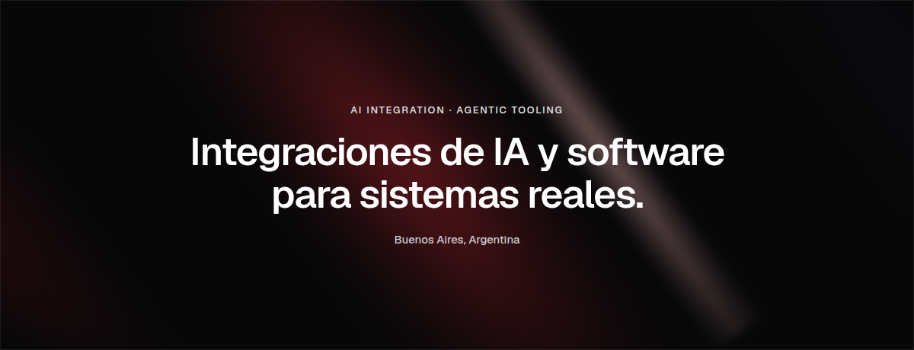

  <a href="https://nicolaspirello.com">Página web de Nicolás Pirello</a>
  ·
  <a href="https://www.linkedin.com/in/nicolas-pirello/">LinkedIn de Nicolás Pirello</a>
  ·
  <a href="mailto:dev@nicolaspirello.com">Correo de Nicolás Pirello</a>
  ·
  <a href="https://nicolaspirello.com/cv-nicolas-pirello.pdf">CV de Nicolás Pirello</a>

### Integraciones de IA

Integraciones MCP propias y extendidas, en uso real con ChatGPT.

**01 · [Balanz MCP](https://nicolaspirello.com/ia/balanz-mcp/)**

Servidor propio y de solo lectura que conecta una cuenta de Balanz con ChatGPT.

**02 · [YouTube Tools](https://nicolaspirello.com/ia/youtube-tools/)**

Extensión para que un modelo vea un video: miniaturas, cuadrículas y transcripción local.

**03 · [Reddit Trends MCP](https://nicolaspirello.com/ia/reddit-trends-mcp/)**

Adaptación de reddit-mcp-server, con un transporte nuevo, para usarlo desde ChatGPT.

**04 · [WebMCP](https://nicolaspirello.com/ia/webmcp/)**

El portafolio expone herramientas para que los agentes del navegador lo consulten sin leer el HTML.

**09 · [YouTube Studio MCP](https://nicolaspirello.com/ia/youtube-studio-mcp/)**

Extensión de youtube-studio-mcp con una bandeja de comentarios sin responder, para contestarlos desde ChatGPT.

[Todas las integraciones](https://nicolaspirello.com/ia/)

### Open source

Contribuciones aceptadas en proyectos de otros.

**10 · [MemHub de Tencent en español](https://nicolaspirello.com/open-source/memhub-espanol/)**

Interfaz en español y preferencia de idioma persistente para MemHub, de [Tencent-Hunyuan/Hy-Memory](https://github.com/Tencent-Hunyuan/Hy-Memory). El equipo la tomó como base de su integración, en la que figuro como co-autor. Mergeada en main · [PR #39](https://github.com/Tencent-Hunyuan/Hy-Memory/pull/39) y [PR #142](https://github.com/Tencent-Hunyuan/Hy-Memory/pull/142).

**11 · [Claude Code UI en español](https://nicolaspirello.com/open-source/claude-code-ui-espanol/)**

Traducción completa al español de [siteboon/claudecodeui](https://github.com/siteboon/claudecodeui), una interfaz web para agentes de código. Mergeada en main · [PR #1624](https://github.com/siteboon/claudecodeui/pull/1624).

[Todas las contribuciones](https://nicolaspirello.com/open-source/)

### Proyectos

Software en producción, usado por gente real.

**05 · [Notificaciones electrónicas](https://nicolaspirello.com/proyectos/notificaciones-electronicas/)**

Sistema en producción. Lo usan unas 30.000 personas.

**06 · [Forxite](https://nicolaspirello.com/proyectos/forxite/)**

Ciberinteligencia. Plataforma interna, plataforma para clientes y [forxite.com](https://forxite.com).

**07 · [Turnos y visitas](https://nicolaspirello.com/proyectos/turnos-y-visitas/)**

Reemplazó la gestión de turnos que se hacía con Word y Gmail.

**08 · [Gestión de salud laboral](https://nicolaspirello.com/proyectos/gestion-salud-laboral/)**

Diseñé la experiencia y la interfaz de un sistema de control médico, la maqueté y la adapté a mobile.

[Todos los proyectos](https://nicolaspirello.com/proyectos/)

Programador en Forxite y en la Subsecretaría de Tecnología e Informática.

React · TypeScript · Python · FastAPI · ASP.NET Core · SQL Server · Docker
