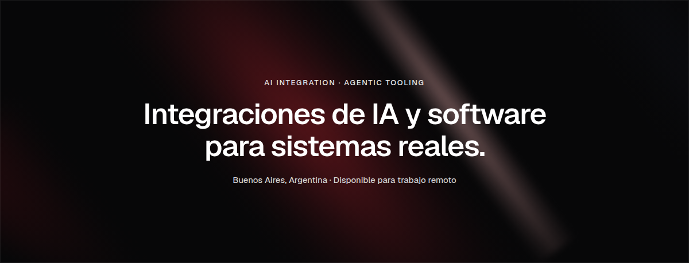

[nicolaspirello.com](https://nicolaspirello.com) · [LinkedIn](https://www.linkedin.com/in/nicolas-pirello/) · [dev@nicolaspirello.com](mailto:dev@nicolaspirello.com) · [CV](https://nicolaspirello.com/cv-nicolas-pirello.pdf)

**01 · [Balanz MCP](https://nicolaspirello.com/ia/balanz-mcp/)**
Servidor propio y de solo lectura que conecta una cuenta de Balanz con ChatGPT.

**02 · [YouTube Tools](https://nicolaspirello.com/ia/youtube-tools/)**
Extensión para que un modelo vea un video: miniaturas, cuadrículas y transcripción local.

**03 · [Notificaciones electrónicas](https://nicolaspirello.com/proyectos/notificaciones-electronicas/)**
Sistema en producción. Lo diseñé y construí solo. Lo usan unas 30.000 personas.

**04 · [Forxite](https://nicolaspirello.com/proyectos/forxite/)**
Ciberinteligencia. Plataforma interna, plataforma para clientes y [forxite.com](https://forxite.com).

[Todos los proyectos](https://nicolaspirello.com/proyectos/)

Programador en Forxite. Desarrollador de software en la Subsecretaría de Tecnología e Informática.

React · TypeScript · Python · FastAPI · ASP.NET Core · SQL Server · Docker
